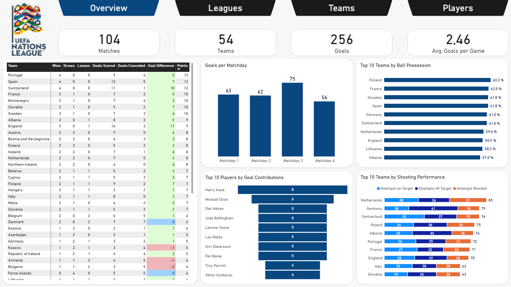

# UEFA Nations League - Power BI Case Study (#06)

###### This case study was developed entirely in **Power BI**, using a **real UEFA Nations League dataset** from Kaggle.

## Executive Summary:
I used **Power Query** to clean and prepare the data for analysis before building the **semantic model** in **Model View**. I established the necessary relationships and cardinalities between the tables, created the required **DAX measures**, and built an interactive Power BI report consisting of four pages: **Overview, Leagues, Teams, and Players**.

Key highlights from this **UEFA Nations League** report are:
1. **League A leads in both speed and accuracy, while League D ranks at the opposite end, highlighting the gap in performance between the highest and lowest league tiers**
2. **Smaller nations and nations from eastern and southeastern europe appear to favour a more physical style of play**
3. **Surprisingly, Rasmus Højlund recorded the highest top speed in the competition at 36.8 km/h, making him the fastest player so far**

###### The final project is fully functional, connected, and tested, combining **data preparation, modeling, visualization, and analysis** in line with the core **PL-300 skills**.

## Objective:
This project aims to analyze and compare the performance of the four Nations League divisions, national teams, and players throughout the competition. The analysis focuses on identifying differences between the **leagues** and comparing **national teams** and **players** across various aspects of the game. The goal is to get a clearer picture of the competition and find interesting insights.

**Key questions:**
1. **How do the four Nations League divisions differ?**
2. **How do national teams compare in different game aspects?**
3. **Which players stand out across key performance indicators?**

 

## Methodology:
1. **Use Power Query to clean, transform, and prepare the data for analysis**
2. **Build a semantic data model in Power BI and create DAX measures for overview, leagues, teams, and players pages**
3. **Build an interactive Power BI report to visualize key metrics, trends, and insights**

## Power BI Skills:
**Power Query:** Data Cleaning, Transformation, Preparation & Merging  
**Data Modeling:** Relationships, Cardinalities, Filters & Formatting  
**DAX:** Measures, Calculated Columns & Calculated Tables  
**Visualization:** Charts, Formatting, KPI Cards, Tooltips & Visual Calculations  
**Analysis:** KPI Analysis, Trend Analysis & Interactive Report Development

## Results & Recommendation:
This report gives us an interactive overview of the UEFA Nations League's **divisions (leagues), teams, and players**. Bringing these areas together in one report makes it easier to monitor key KPIs, identify trends, and compare performance without having to rely on separate manual analyses.

This report highlighted many key findings, some of them are:

* **Overview Page:** **Germany** ranked among the top 3 teams in shooting attempts, but also recorded the highest number of attempts off target among the top 10. More than **50%** of their shots missed the target. Despite taking **79 attempts**, Germany scored only **3 goals**, resulting in a Attempt-to-Goal rate of just **3.8%**. These figures suggest that German players need to be more decisive in front of goal and improve their shooting accuracy.
* **Leagues Page:** **League A** scored the most goals, had the highest shooting and passing accuracy, fastest gameplay and featured the fastest players. **League D**, on the other hand, had lower scoring and accuracy, and slower gameplay, but was by far the most physical division, averaging **29.4** fouls per game compared to **21.5** in League A. This clearly shows the differences in playing style between the top and bottom divisions.
* **Teams Page:** **Norway** was surprisingly the fastest nation by median top speed at **31.61 km/h**, just slightly ahead of **Germany (31.59 km/h**). **England** scored the most goals **(14)** while matching **Spain's** highest shooting accuracy **(20%)**, despite taking **10 times** as many shots. Maintaining the same accuracy with significantly more attempts makes this an even more impressive result. **Andorra** stood out as the most aggressive team, averaging **21.3 fouls** per game.
* **Players Page:** **Rasmus Højlund (DEN)** was by far the fastest player, recording a top speed of **36.8 km/h**. **Martin Ødegaard (NOR)** covered the most distance (**48.5 km**) and shared the top assist spot with **Jude Bellingham (4) (ENG)**. Interestingly, midfielders averaged slightly more fouls per player (**2.54**) than defenders (**2.48**), making them the most physical player position.

Based on this analysis, I would recommend the following actions:
1. **Improve Shooting Accuracy:** German players should be more decisive in front of goal and focus on improving the shooting accuracy.
2. **Focus on Gameplay Speed and Accuracy rather than Physical Duels:** Teams from lower divisions should focus more on improving their gameplay speed, passing accuracy, and overall technical performance rather than relying too heavily on physical duels. This could help them become more competitive and close the gap with higher divisions.
3. **Use Player Statistics to Support Selection Decisions:** National teams should use player statistics to identify their strongest performers and make better decisions when selecting players and assigning roles. Metrics such as goals, assists, shooting accuracy, passing accuracy, distance covered, and top speed can help identify players who bring the most value to the team.

I believe these recommendations would help national teams improve their overall performance, make better use of player strengths, and become more competitive.

## Next Steps:
1. **Expand the Analysis:** Analyze team performances over the previous two years to identify trends and changes over time
2. **Continue Monitoring the Tournament:** Wait for the competition to continue, then update the dataset and keep analyzing the results
3. **Expand the Report:** Add more pages, such as Matchday Analysis, and include more detailed team and player statistics
